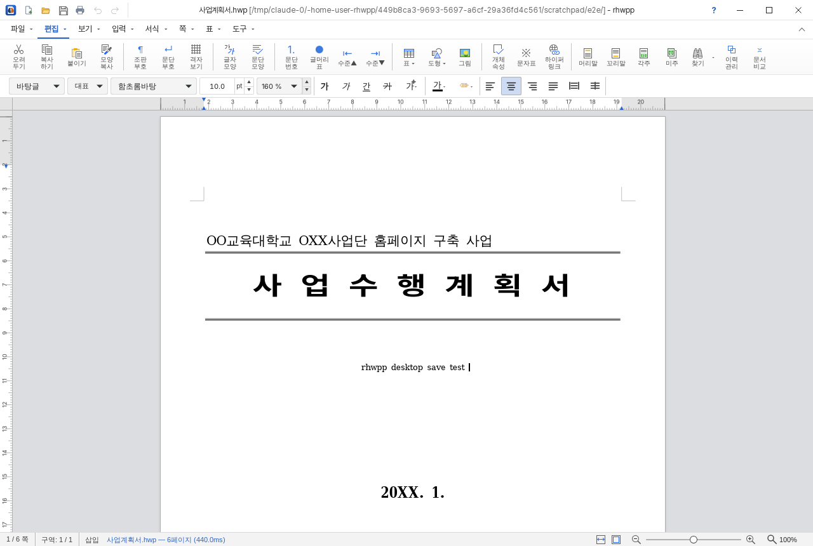

# rhwpp — Windows용 한글(HWP) 워드프로세서

[rhwp](https://github.com/edwardkim/rhwp)(Rust + WebAssembly 한글 문서 엔진과 웹 편집기)를
**Windows 데스크톱 프로그램으로 완전 포팅**하고, 화면과 조작을 한글 2022에 최대한 맞춘 프로젝트입니다.
업스트림 rhwp의 모든 편집 기능을 그대로 쓰면서 네이티브 파일 입출력, 탐색기 연결, 여러 창,
한글식 제목 표시줄·탭 리본·단축키를 더했습니다. 업스트림은 고정 커밋으로 받아 빌드하므로
`npm run upstream:update` 한 번으로 새 기능을 동기화할 수 있습니다.



## 주요 기능

### 문서
- HWP 5.0 / HWPX 열기·편집·저장, HML(HWPML 2.9/2.91) 가져오기·저장
- HWP ↔ HWPX 형식 변환 저장, 다른 이름으로 저장(문서 암호 설정 포함), 암호 걸린 HWP 열기
- PDF로 저장(인쇄 대화상자의 "PDF로 저장"), HTML·Word(.doc) 내보내기
- 인쇄 미리보기와 인쇄, 편집 용지 설정
- 자동 저장과 비정상 종료 뒤 복구, 문서 이력 관리, 문서 비교

### 편집 (업스트림 rhwp 엔진)
- 글자 모양·문단 모양·스타일, 문단 번호·글머리표·수준 증감, 모양 복사
- 표: 만들기, 줄/칸 추가·삭제, 셀 합치기·나누기, 셀 크기 같게, 표/셀 속성·테두리, 계산식,
  블록 합계·평균·곱, 1,000 단위 쉼표, 행/열 바꿈 복사
- 도형·그림·글상자·수식·차트, 개체 속성·배치·묶기, 캡션
- 머리말·꼬리말·각주·미주, 쪽 번호, 다단·단 나누기·쪽 나누기, 구역 설정, 쪽 테두리/배경
- 찾기·찾아 바꾸기·찾아가기, 하이퍼링크·책갈피·필드(누름틀), 양식 모드
- 조판 부호·문단 부호·투명 선·격자 보기, 화면 확대/축소(쪽 맞춤·폭 맞춤)
- 한컴 호환 hwpctl 자동화 API, 명령 찾기(Ctrl+/)

### Windows 통합 (rhwpp가 더한 것)
- Windows 기본 **열기/저장 대화상자**, 실제 경로에 바로 저장(원자적 저장)
- `.hwp` `.hwpx` `.hml` **연결 프로그램 등록** — 탐색기에서 두 번 누르면 열림
- **단일 인스턴스**: 이미 실행 중이면 새 창으로 문서를 엶
- **끌어다 놓기**: 문서는 열고(편집 중이면 새 창), 그림은 놓은 자리에 삽입
- **문서 탭**: 한글처럼 아래쪽에 열린 문서가 탭으로 보이고, 탭을 누르면 그 문서로 전환, ×로 닫기,
  +로 새 문서. 문서마다 독립 창(한 문서가 멈춰도 다른 문서는 안전)이지만 같은 자리에 겹쳐 열려 탭처럼 동작
- 닫거나 끝낼 때 **저장 확인**, 정상 종료 시 자동 저장 복구본 정리, 창 위치·크기 기억
- **최근 문서** 다시 열기(프로그램을 다시 켜도 유지), 탐색기에서 파일 위치 열기
- 인쇄 미리보기 창, 클립보드 붙이기와 설치된 글꼴 목록을 권한 질문 없이 사용
- 인터넷 없이 동작(엔진·글꼴 모두 내장, 서비스 워커 없음)

### 한글 2022 식 화면
- **제목 표시줄**: 앱 아이콘, 빠른 실행 도구(새 문서·불러오기·저장·인쇄·되돌리기·다시 실행),
  `문서.hwp [C:\폴더\] - rhwpp` 형식 제목, 창 단추
- **탭 메뉴 + 기본 도구 상자(리본)**: 메뉴 이름(파일·편집·보기·입력·서식·쪽·표·도구)을 누르면
  그 탭의 도구가 리본에 나타나고, 이름 옆 **▾**를 누르면 펼침 메뉴(열림 상자)가 열립니다.
  메뉴 이름을 두 번 누르면 도구 상자를 접고 폅니다. 문맥에 맞지 않는 도구는 흐리게 표시됩니다.
- 서식 도구 상자, 가로·세로 눈금자, 쪽 윤곽, 문서 탭, 상태 표시줄(쪽/구역/삽입·수정/확대 비율)
- 한글 색상과 맑은 고딕 UI. 보기 › 테마에서 모던·올드스쿨 스킨, 어두운 화면도 고를 수 있습니다.

## 설치

### 명령어 한 줄로 설치 (권장)

설치할 PC에서 PowerShell을 열고(시작 단추 → `PowerShell` 입력) 아래 한 줄을 붙여 넣습니다.
새로 설치할 때는 관리자 권한이 필요 없습니다.

```powershell
[Net.ServicePointManager]::SecurityProtocol = 'Tls12'; irm https://github.com/woo202/rhwpp/releases/latest/download/install.ps1 | iex
```

- 앞부분(`SecurityProtocol = 'Tls12'`)은 TLS 1.0이 기본값으로 남아 있는 오래된 Windows 10에서도 GitHub에
  접속되게 합니다.
- 최신 릴리스의 설치 파일을 받아 릴리스의 `SHA256SUMS.txt`와 SHA-256 값을 맞춰 본 뒤, 현재 사용자용으로
  조용히 설치합니다(`%LOCALAPPDATA%\Programs\rhwpp`). 시작 메뉴·바탕 화면 바로 가기와 `.hwp`·`.hwpx`·`.hml`
  파일 연결도 만듭니다.
- 같은 명령을 다시 실행하면 새 버전으로 업데이트합니다. 이미 최신이거나 더 새 버전이 깔려 있으면 아무것도
  하지 않고, 업데이트할 때는 지운 바로 가기를 다시 만들지 않습니다.
- 이미 모든 사용자용(`Program Files`)으로 깔려 있으면 그 설치를 업데이트하므로 관리자 확인 창이 뜹니다.
- 바꿀 rhwpp가 열려 있으면 문서를 저장하고 닫을 때까지 기다립니다.
- MSI로 설치한 rhwpp가 있으면 설치하지 않고 멈춥니다. `-Uninstall`로 먼저 지우세요.
- 명령 프롬프트(cmd)나 실행 창(Win+R)에서는 다음 한 줄을 씁니다. 결과를 읽을 수 있게 창이 열린 채로
  남으니, 다 읽었으면 닫으면 됩니다.

  ```bat
  powershell -NoExit -NoProfile -Command "[Net.ServicePointManager]::SecurityProtocol='Tls12'; irm https://github.com/woo202/rhwpp/releases/latest/download/install.ps1 | iex"
  ```

옵션을 주려면 스크립트 블록으로 실행합니다. 예: 모든 사용자용 설치

```powershell
[Net.ServicePointManager]::SecurityProtocol = 'Tls12'; & ([scriptblock]::Create((irm https://github.com/woo202/rhwpp/releases/latest/download/install.ps1))) -AllUsers
```

| 옵션 | 뜻 |
| --- | --- |
| `-AllUsers` | 이 PC의 모든 사용자용으로 `Program Files`에 설치합니다(관리자 확인 창이 뜹니다). 현재 사용자용 설치가 있으면 모든 사용자용 설치가 끝난 뒤 지워서 하나만 남깁니다. |
| `-Version 0.1.0` | 최신 대신 지정한 릴리스를 설치합니다(낮은 버전으로 되돌릴 때도 씁니다). |
| `-Launch` | 설치가 끝나면 rhwpp를 실행합니다. |
| `-Force` | 같은 버전이나 더 새 버전이 깔려 있어도 다시 설치하고, 실행 중인 rhwpp를 묻지 않고 닫습니다(저장하지 않은 내용은 사라집니다). |
| `-Uninstall` | rhwpp를 제거합니다(MSI로 설치한 것 포함). 문서와 설정은 남깁니다. |

관리자 권한으로 연 PowerShell에서 실행하면 그 관리자 계정에 설치됩니다. 다른 계정에 설치하려면 그 계정으로
로그인해 일반 PowerShell 창에서 실행합니다.

### 직접 받아 설치

1. [Releases](../../releases/latest)에서 설치 파일을 받거나, [Actions](../../actions/workflows/build-windows.yml)의
   최근 성공한 빌드에서 `rhwpp-windows-x64` 산출물을 받습니다.
2. `rhwpp_x.y.z_x64-setup.exe`(NSIS) 또는 `rhwpp_x.y.z_x64_ko-KR.msi`를 실행합니다. 코드 서명이 없어서
   브라우저로 받은 파일은 "Windows의 PC 보호" 창이 뜰 수 있습니다. **추가 정보 → 실행**을 누릅니다.
   설치 없이 쓰려면 `rhwpp-portable-x64.zip` 안의 `rhwpp.exe`를 실행합니다.
3. Windows 10/11에 기본 포함된 Microsoft Edge WebView2 런타임을 씁니다. 없으면 설치 프로그램이
   함께 설치합니다.

### 릴리스 게시 (관리자)

`package.json`의 `version`과 같은 `v*` 태그를 올리면 CI가 빌드·검사한 뒤 GitHub 릴리스에 설치 파일,
MSI, 휴대용 zip, `install.ps1`, `SHA256SUMS.txt`를 올립니다. 한 줄 설치 명령은 이 최신 릴리스를 씁니다.

```sh
git tag v0.1.0
git push origin v0.1.0
```

## 단축키 (한글 기준)

| 기능 | 단축키 | 기능 | 단축키 |
| --- | --- | --- | --- |
| 새 문서 | Alt+N | 새 창 | Ctrl+Alt+N |
| 불러오기 | Alt+O / Ctrl+O | 저장하기 | Alt+S / Ctrl+S |
| 다른 이름으로 저장 | Alt+V / Ctrl+Shift+S | 인쇄 | Alt+P / Ctrl+P |
| 문서 닫기 | Ctrl+F4 | 끝 | Alt+X |
| 글자 모양 | Alt+L | 문단 모양 | Alt+T |
| 스타일 | F6 | 편집 용지 | F7 |
| 모양 복사 | Alt+C | 문자표 | Alt+F10 |
| 양쪽 정렬 | Ctrl+Shift+M | 왼쪽 정렬 | Ctrl+Shift+L |
| 가운데 정렬 | Ctrl+Shift+C | 오른쪽 정렬 | Ctrl+Shift+R |
| 배분 정렬 | Ctrl+Shift+T | 찾기 / 찾아 바꾸기 | Ctrl+F / Ctrl+F2 |
| 찾아가기 | Alt+G | 줄/칸 추가·지우기 | Alt+Insert / Alt+Delete |
| 조판 부호 | Ctrl+G,C | 문단 부호 | Ctrl+G,T |
| 쪽 맞춤 / 폭 맞춤 | Ctrl+G,P / Ctrl+G,W | 명령 찾기 | Ctrl+/ |

새로 고침(F5)·뒤로 가기(Alt+←) 같은 브라우저 단축키는 문서가 사라지지 않도록 막혀 있습니다.

## 직접 빌드하기

필요한 것: Windows 10/11, [Node.js 22](https://nodejs.org/), [Rust](https://rustup.rs/)(stable, MSVC),
`cargo install wasm-pack@0.15.0`, Git. (업스트림 엔진은 `upstream/rhwp/rust-toolchain.toml`의
Rust 1.93.1로 자동 빌드됩니다.)

```powershell
npm ci
npm run upstream:fetch   # upstream.json 에 고정된 rhwp 커밋을 sparse checkout (수백 MB)
npm run build:wasm       # 문서 엔진 → WebAssembly
npm run build            # 프런트엔드 빌드 + Tauri 설치 파일 (src-tauri/target/release/bundle)
```

개발 중에는 `npm run dev`로 핫 리로드 창을 띄웁니다. Linux에서 Windows 설치 파일을 만들려면
mingw-w64·NSIS를 설치하고 `npx tauri build --target x86_64-pc-windows-gnu --bundles nsis`를 씁니다.

| 명령 | 내용 |
| --- | --- |
| `npm run upstream:status` | 고정 커밋과 현재 체크아웃 비교 |
| `npm run upstream:update` | 업스트림 최신 커밋으로 `upstream.json` 갱신(기능 동기화) |
| `npm run build:web` | `dist/`에 프런트엔드만 빌드 |
| `npm run typecheck` | 오버레이 + 업스트림 스튜디오 타입 검사 |
| `npm test` / `cargo test --manifest-path src-tauri/Cargo.toml` | 단위 테스트 |

## 업스트림 동기화

```powershell
npm run upstream:update   # 최신 main 으로 이동, upstream.json 갱신
npm run build:wasm -- --force
npm run typecheck && npm run build
git commit -am "rhwp 업스트림 동기화"
```

rhwpp는 업스트림 코드를 고치지 않습니다. 오버레이가 기대하는 접점(아래 표)이 바뀌면 타입 검사나
빌드가 실패하므로 동기화 때 바로 알 수 있습니다.

## 구조

```
rhwpp/
├─ upstream.json            업스트림 rhwp 저장소·고정 커밋
├─ scripts/                 upstream.mjs(sparse checkout/동기화), build-wasm.mjs, build-web.mjs
├─ desktop/                 프런트엔드 오버레이 (업스트림 rhwp-studio 위에 덧입힘)
│  ├─ vite.config.ts        업스트림 vite 설정 상속, PWA 제거, 오프라인 글꼴, 부트 스크립트 주입
│  └─ src/
│     ├─ boot.ts            스튜디오보다 먼저 실행: 네이티브 API 주입, 제목 표시줄·리본 생성
│     ├─ native/            파일 핸들·선택기·launchQueue·내려받기 → Rust 명령
│     ├─ ui/                제목 표시줄, 탭 리본, 단축키, 끌어다 놓기, 창 수명주기, 데스크톱 명령
│     ├─ overrides/         업스트림 모듈 래퍼(최근 문서 핸들 복원)
│     └─ styles/hangul.css  한글 2022 식 스킨
└─ src-tauri/               Rust 셸 (Tauri 2 + WebView2)
   └─ src/                  창 관리, 파일 대화상자·읽기/쓰기, 접근 범위, 단일 인스턴스, 실행 인자
```

| 업스트림 접점 | rhwpp가 하는 일 |
| --- | --- |
| `window.showOpenFilePicker` / `showSaveFilePicker` | Windows 대화상자 + 경로 기반 파일 핸들로 대체 → 스튜디오의 열기/저장 흐름이 실제 경로로 동작 |
| `window.launchQueue` (PWA 파일 처리) | 실행 인자·두 번째 인스턴스·끌어다 놓기 문서를 같은 통로로 전달 |
| `<a download>` 내려받기 | 저장 대화상자로 위치 선택 |
| `window.rhwpStudio.automation` | 데스크톱 명령(`ext:rhwpp.*`) 등록, 명령 실행·활성 판정 |
| `.tb-btn[data-cmd]` 툴바 마크업 | 탭별 리본 버튼을 같은 마크업으로 미리 넣어 스튜디오가 직접 연결 |
| `main.ts` 내부 서비스 | 빌드 시 `window.__rhwppInternals`로 노출(저장 확인·이벤트). 없으면 공개 API로 폴백 |

## 보안

- 웹뷰는 앱 내부 페이지만 불러오고(CSP 적용), 외부 링크는 기본 브라우저로 엽니다.
- 파일 읽기/쓰기는 사용자가 대화상자에서 고르거나, 실행 인자·끌어다 놓기로 넘어왔거나,
  예전에 열었던 문서 경로로만 제한됩니다.
- 인쇄 미리보기 같은 팝업 창은 앱 명령을 호출할 수 없습니다.

## 알려진 제한

- 편집·렌더링 정확도는 업스트림 rhwp 엔진의 현재 수준을 따릅니다(로드맵: [rhwp ROADMAP](https://github.com/edwardkim/rhwp/blob/main/ROADMAP.md)).
- 한글의 보안(배포용 문서)·검토(변경 추적, 맞춤법) 메뉴처럼 엔진에 없는 기능은 넣지 않았습니다.
- 문서 탭은 문서마다 별도의 창을 겹쳐 놓는 방식이라 작업 표시줄에 창이 문서 수만큼 보입니다.

## 라이선스

MIT. 문서 엔진과 웹 편집기는 [rhwp](https://github.com/edwardkim/rhwp)(© Edward Kim 및 기여자, MIT)입니다.
"한글", "HWP"는 (주)한글과컴퓨터의 상표이며, 이 프로젝트는 한글과컴퓨터와 관련이 없습니다.
